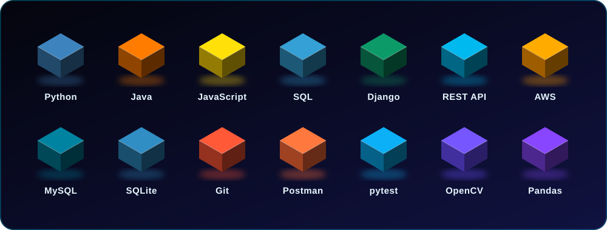

  

  

  
  
  
  

  
  
  
  

  

 

<h2 align="center">ABOUT</h2>

  <i>I turn ideas into working software: APIs that respond, databases that hold up, 
  tests that catch mistakes, and deployments people can actually open.</i>

  MCA Graduate 2026 &nbsp;·&nbsp; Pune, India &nbsp;·&nbsp; Available for immediate joining 
  Currently sharpening Core Java, Data Structures &amp; Algorithms and LeetCode. 
  Drawn to backend engineering, databases and machine learning.

 

<h2 align="center">TECH STACK</h2>

  

 

<h2 align="center">PROJECT SHOWCASE</h2>

Six builds. Click any card to open its source code.

<!-- 01 -->

  

  
  

 

<!-- 02 -->

  

  
  

 

<!-- 03 -->

  

  

 

<!-- 04 -->

  

  
  

 

<!-- 05 -->

  

  
  

 

<!-- 06 -->

  

  

 

<h2 align="center">MY JOURNEY</h2>

  

 

<h2 align="center">HOW I WORK</h2>

  

<i>Good software comes from continuous learning, thoughtful engineering and attention to detail.</i>

 

<h2 align="center">EDUCATION &amp; CERTIFICATIONS</h2>

  

  

 

<h2 align="center">DEVELOPER ACTIVITY</h2>

  
  

  

  

  

 

<h2 align="center">LET'S CONNECT</h2>

Have an interesting project, collaboration or opportunity? Let's build something meaningful.

  
  
  

<b>OPEN TO SOFTWARE DEVELOPER OPPORTUNITIES</b>

<i>Code. Create. Innovate. Repeat.</i>

  

